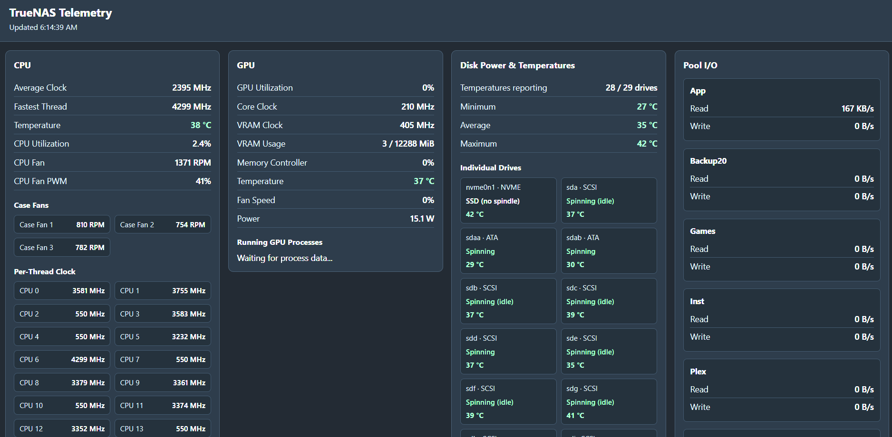

# TrueNAS Telemetry

A lightweight Flask dashboard that shows live hardware telemetry from a TrueNAS
server: CPU clocks, temperatures and fans, NVIDIA GPU stats and processes,
per-drive power state and temperature, and ZFS pool I/O. It can also show CPU,
GPU, temperature and storage I/O stats from a Mac.



## How it works

The dashboard connects to the TrueNAS host over SSH (key-based, via Paramiko)
and runs read-only commands such as `nvidia-smi`, `zpool iostat`, and the disk
probe in `disk_probe.py`. The disk probe checks spin state without waking idle
drives; see [DISK_POWER.md](DISK_POWER.md) for details.

## Configuration

Set these environment variables:

| Variable   | Default                       | Description                      |
|------------|-------------------------------|----------------------------------|
| `SSH_HOST` | `10.0.0.10`                   | TrueNAS host address             |
| `SSH_PORT` | `22`                          | SSH port                         |
| `SSH_USER` | `truenas_admin`               | SSH user                         |
| `SSH_KEY`  | `/run/secrets/dashboard_key`  | Path to the SSH private key      |

The SSH account needs device access (or passwordless `sudo`) for `hdparm`,
`sg_requests`, `sg_logs`, and `smartctl`.

### Optional: a Mac

Set `MAC_SSH_HOST` to add a card with an Apple Silicon Mac's average CPU and
GPU utilization, temperatures, and per-disk read/write throughput. On Intel
Macs, CPU and storage I/O work, but temperatures and GPU utilization are
likely to be unavailable. The dashboard
runs `mac_probe.py` over SSH with the system `/usr/bin/python3` (from the Xcode
command line tools); it needs no `sudo`.

| Variable       | Default     | Description                          |
|----------------|-------------|--------------------------------------|
| `MAC_SSH_HOST` | *(unset)*   | Mac address; unset hides the card    |
| `MAC_SSH_PORT` | `22`        | SSH port                             |
| `MAC_SSH_USER` | *(unset)*   | Mac user to log in as                |
| `MAC_SSH_KEY`  | `SSH_KEY`   | Path to the SSH private key          |

On the Mac, turn on **System Settings → General → Sharing → Remote Login** and
add the dashboard's public key to that user's `~/.ssh/authorized_keys`,
prefixed with `restrict ` to disable forwarding and terminals.

Temperatures on Apple Silicon come from unlabeled sensors, so they are grouped:
**SoC die** (`tdie*`), **SoC package** (`tdev*`), **SSD** (NAND), and
**Battery** where present. Each tile shows the group average and is colored by
its hottest sensor (hover for details). Fan speeds are not reported.

## Running

```bash
pip install -r requirements.txt
python app.py                                  # dev server on :8080
# or
gunicorn -b 0.0.0.0:8080 app:app
```

Then open `http://<host>:8080`. A `/health` endpoint is available for checks.

## Tests

```bash
pip install -r requirements.txt   # tests import app.py
python3 -m unittest discover -s tests -v
```
