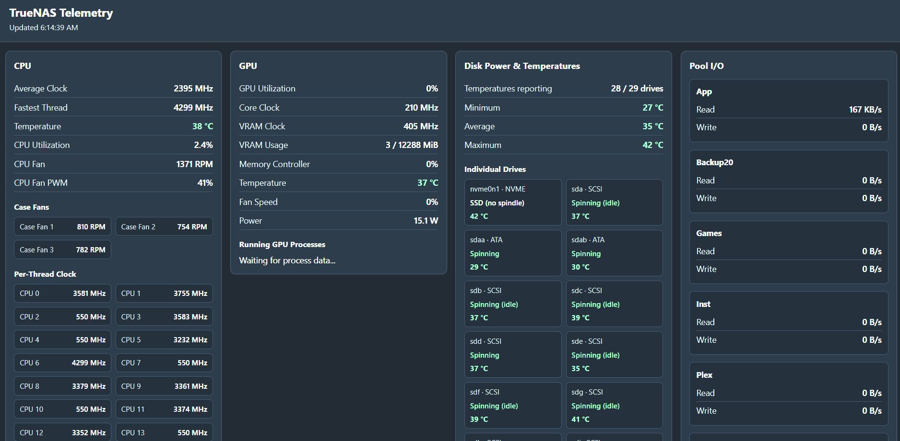

# TrueNAS Telemetry

A lightweight Flask dashboard that shows live hardware telemetry from a TrueNAS
server: CPU clocks, temperatures and fans, NVIDIA GPU stats, per-drive power
state and temperature, and ZFS pool I/O.



## How it works

The dashboard connects to the TrueNAS host over SSH (key-based, via Paramiko)
and runs read-only commands such as `nvidia-smi`, `zpool iostat`, and the disk
probe in `disk_probe.py`. The disk probe checks spin state without waking idle
drives; see [DISK_POWER.md](DISK_POWER.md) for details.

## Configuration

Set these environment variables:

| Variable   | Default                       | Description                      |
|------------|-------------------------------|----------------------------------|
| `SSH_HOST` | `10.0.0.10`                   | TrueNAS host address             |
| `SSH_PORT` | `22`                          | SSH port                         |
| `SSH_USER` | `truenas_admin`               | SSH user                         |
| `SSH_KEY`  | `/run/secrets/dashboard_key`  | Path to the SSH private key      |

The SSH account needs device access (or passwordless `sudo`) for `hdparm`,
`sg_requests`, `sg_logs`, and `smartctl`.

## Running

```bash
pip install -r requirements.txt
python app.py                                  # dev server on :8080
# or
gunicorn -b 0.0.0.0:8080 app:app
```

Then open `http://<host>:8080`. A `/health` endpoint is available for checks.

## Tests

```bash
python3 -m unittest discover -s tests -v
```
